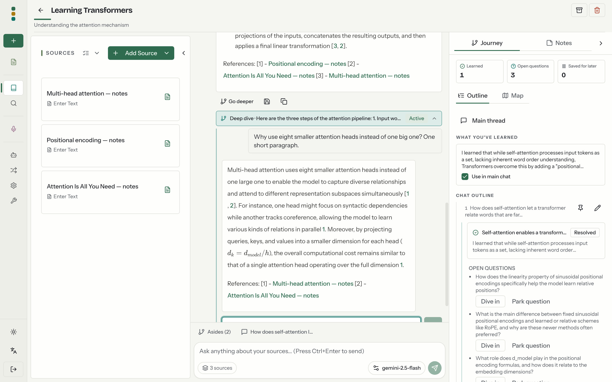
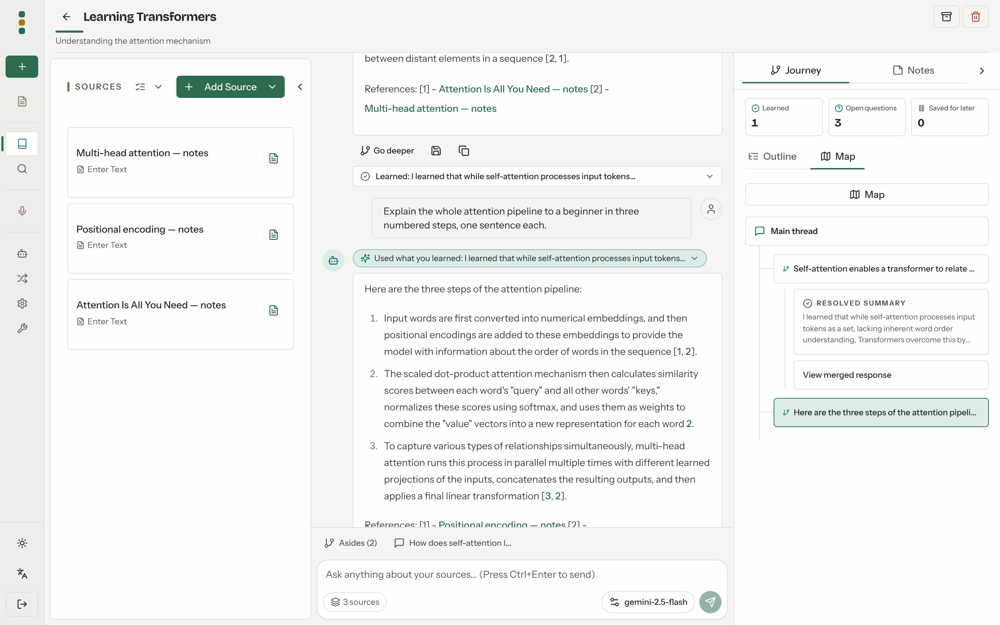

<a id="readme-top"></a>

[![Forks][forks-shield]][forks-url]
[![Stargazers][stars-shield]][stars-url]
[![Issues][issues-shield]][issues-url]
[![MIT License][license-shield]][license-url]


<!-- PROJECT LOGO -->
<br />
<div align="center">
  <a href="https://github.com/KilroyHere/open-notebook-factory">
    
  </a>

  <h3 align="center">Open Notebook Factory</h3>

  <p align="center">
    An open source, privacy-focused alternative to Google's Notebook LM that helps you learn from your research.
    <br />
    <br />
    <a href="docs/0-START-HERE/index.md">📚 Get Started</a>
    ·
    <a href="docs/3-USER-GUIDE/index.md">📖 User Guide</a>
    ·
    <a href="docs/3-USER-GUIDE/deep-dives.md">🔎 Deep Dives</a>
    ·
    <a href="docs/2-CORE-CONCEPTS/index.md">✨ Features</a>
    ·
    <a href="docs/1-INSTALLATION/index.md">🚀 Deploy</a>
  </p>
</div>

## About this fork

Open Notebook Factory is based on [Open Notebook](https://github.com/lfnovo/open-notebook) by Luis Novo (MIT License). It does everything Open Notebook does, and adds:

- **Deep dives.** **Go deeper** on an answer, or on a passage you select, opens a thread under that answer, so the main conversation stays where it was. Dives can nest, and **Wrap up** turns a dive into a conclusion with open questions.
- **Main chat uses what you learned.** Resolved conclusions go with every main-chat message, within a context limit. A **Use in main chat** switch takes each one in or out, and markers show the ones the limit leaves out.
- **A Journey tab in Studio**: an outline of the conversation, a map of its branches, and counts of what you've learned, open questions and dives saved for later.
- **A learning API** under `/api/learning` ([API reference](docs/7-DEVELOPMENT/api-reference.md)).
- **One-command hosting** with `docker-compose.host.yml`, a script that installs the development prerequisites on Debian and Ubuntu, and end-to-end tests.
- **A three-panel notebook layout** (Sources, Chat, Studio) and a new message box.

The fork keeps in sync with upstream: it merges Open Notebook's `main` from time to time ([Syncing with Upstream](docs/7-DEVELOPMENT/syncing-upstream.md)). The [CHANGELOG](CHANGELOG.md) lists the changes.

## A private, multi-model, 100% local, full-featured alternative to Notebook LM



In a world dominated by Artificial Intelligence, having the ability to think 🧠 and acquire new knowledge 💡, is a skill that should not be a privilege for a few, nor restricted to a single provider.

**Open Notebook Factory empowers you to:**
- 🔒 **Control your data** - Keep your research private and secure
- 🤖 **Choose your AI models** - 20+ providers including OpenAI, Anthropic, Google, Mistral, Ollama and any OpenAI-compatible server (LM Studio, vLLM)
- 🔎 **Learn as you research** - Follow a tangent in a deep dive without losing your place, and keep what you learned in the conversation
- 📚 **Organize multi-modal content** - PDFs, videos, audio, web pages, and more
- 🎙️ **Generate professional podcasts** - Advanced multi-speaker podcast generation
- 🔍 **Search intelligently** - Full-text and vector search across all your content
- 💬 **Chat with context** - AI conversations powered by your research
- 🌐 **Multi-language UI** - English, Bengali, Catalan, Chinese (Simplified & Traditional), French, German, Italian, Japanese, Polish, Portuguese, Russian, Spanish and Turkish

---

## 🆚 Open Notebook Factory vs Google Notebook LM

| Feature | Open Notebook Factory | Google Notebook LM | Advantage |
|---------|---------------|--------------------|-----------|
| **Privacy & Control** | Self-hosted, your data | Google cloud only | Complete data sovereignty |
| **AI Provider Choice** | 20+ providers, cloud or local (OpenAI, Anthropic, Google, Ollama, LM Studio, etc.) | Google models only | Flexibility and cost optimization |
| **Podcast Speakers** | 1-4 speakers with custom profiles | 2 speakers only | Extreme flexibility |
| **Content Transformations** | Custom and built-in | Limited options | Unlimited processing power |
| **API Access** | Full REST API | No API | Complete automation |
| **Deployment** | Docker, cloud, or local | Google hosted only | Deploy anywhere |
| **Citations** | Answers cite the sources, notes and insights they used | Comprehensive with sources | Research integrity |
| **Customization** | Open source, fully customizable | Closed system | Unlimited extensibility |
| **Cost** | Pay only for AI usage | Free tier + Monthly subscription | Transparent and controllable |

**Why Choose Open Notebook Factory?**
- 🔒 **Privacy First**: Your sensitive research stays completely private
- 💰 **Cost Control**: Choose cheaper AI providers or run locally with Ollama
- 🔎 **Learning Built In**: Deep dives keep tangents out of the main thread until you approve what they taught you
- 🎙️ **Better Podcasts**: Full script control and multi-speaker flexibility vs Notebook LM's 2-speaker audio overviews
- 🔧 **Unlimited Customization**: Modify, extend, and integrate as needed
- 🌐 **No Vendor Lock-in**: Switch providers, deploy anywhere, own your data

### Built With

[![Python][Python]][Python-url] [![Next.js][Next.js]][Next-url] [![React][React]][React-url] [![SurrealDB][SurrealDB]][SurrealDB-url] [![LangChain][LangChain]][LangChain-url]

## 🚀 Quick Start

There are two ways to run it: build this repository yourself, or install the published image.

### Host this repository locally

This is the command to send someone who should run the code in this repository. They need Docker with Compose. They do not need Python, Node, or a separate database install.

```bash
git clone https://github.com/KilroyHere/open-notebook-factory.git
cd open-notebook-factory
docker compose -f docker-compose.host.yml up --build
```

When the build finishes, open **http://localhost:8502**. The API is at **http://localhost:5055**. Stop it with Ctrl+C. To run it in the background, add `-d`, and stop it later with `docker compose -f docker-compose.host.yml down`.

The first start builds the image from this checkout, so it takes longer than pulling a published image. Chat still needs a provider: in the sidebar open **Models**, add a configuration, then **Auto-assign Defaults**.

### Install the published image

These steps install the latest release, `ghcr.io/kilroyhere/open-notebook-factory:v1-latest`, without cloning or building anything.

#### Prerequisites
- [Docker Desktop](https://www.docker.com/products/docker-desktop/) (macOS, Windows) or Docker Engine with the Compose plugin (Linux)
- An API key from an AI provider, or a local model server such as Ollama. You add it in the UI, not in config files.

#### Step 1: Download docker-compose.yml
```bash
mkdir open-notebook && cd open-notebook
curl -o docker-compose.yml https://raw.githubusercontent.com/KilroyHere/open-notebook-factory/main/docker-compose.yml
```

This is the [docker-compose.yml](docker-compose.yml) from this repository. It runs two services: `surrealdb` (the database) and `open_notebook` (UI, API and background worker, from the `ghcr.io/kilroyhere/open-notebook-factory` image).

#### Step 2: Set your encryption key
Edit `docker-compose.yml` and change this line:
```yaml
- OPEN_NOTEBOOK_ENCRYPTION_KEY=change-me-to-a-secret-string
```
to a long random secret you generate yourself (for example with `openssl rand -hex 32`; [other options](docs/1-INSTALLATION/docker-compose.md#step-2-set-your-encryption-key)). It encrypts the API keys you store; keep it.

> **Shared network or server?** The UI (`8502`) and API (`5055`) are published on all network interfaces and there is no password by default. If other devices can reach this machine, change those two port lines to `"127.0.0.1:8502:8502"` and `"127.0.0.1:5055:5055"`, or add `- OPEN_NOTEBOOK_PASSWORD=your-password` to the `environment:` block, before starting.

#### Step 3: Start services
```bash
docker compose up -d
```

Wait about 30 seconds, then open: **http://localhost:8502**

#### Step 4: Connect an AI provider
1. In the sidebar, open **Models** (under Manage).
2. Find your provider (OpenAI, Anthropic, Google, etc.) and click **Add Configuration**.
3. Enter a name and your API key (local providers such as Ollama need a **Base URL** instead), then click **Add Configuration**.
4. Click **Test** on the new configuration to check the connection.
5. Click **Models**, choose a **Model Type**, tick the models to add and click **Add**. Add at least one **Language** model and one **Embedding** model.
6. Under **Default Model Assignments**, click **Auto-assign Defaults** (or pick the models yourself).

Done. Create a notebook, add a source and start chatting; then try **Go deeper** under an answer ([Deep Dives](docs/3-USER-GUIDE/deep-dives.md)). Full walkthrough: [Connect a provider](docs/4-AI-PROVIDERS/index.md#connect-a-provider).

> **Need an API key?** Get one from:
> [OpenAI](https://platform.openai.com/api-keys) · [Anthropic](https://console.anthropic.com/settings/keys) · [Google](https://aistudio.google.com/app/apikey) · [Groq](https://console.groq.com/keys)
>
> Anthropic and Groq have no embedding models; pair them with a provider that does (see the [matrix](#provider-support-matrix)).

> **Want free local AI?** See the [Local Quick Start](docs/0-START-HERE/quick-start-local.md) (Ollama in Docker).

---

### 📚 More Installation Options

- **[Local AI with Ollama](docs/0-START-HERE/quick-start-local.md)** - Run models locally without API costs
- **[Docker Compose guide](docs/1-INSTALLATION/docker-compose.md)** - Settings, backups, updates, remote access
- **[From Source (Developers)](docs/1-INSTALLATION/from-source.md)** - For development and contributions
- **[Complete Installation Guide](docs/1-INSTALLATION/index.md)** - All deployment scenarios

---

## Provider Support Matrix

Thanks to the [Esperanto](https://github.com/lfnovo/esperanto) library, we support these providers out of the box. The columns show the model types each provider offers; what you can use depends on your account.

| Provider     | LLM Support | Embedding Support | Speech-to-Text | Text-to-Speech |
|--------------|-------------|------------------|----------------|----------------|
| OpenAI       | ✅          | ✅               | ✅             | ✅             |
| Anthropic    | ✅          | ❌               | ❌             | ❌             |
| Google (GenAI) | ✅          | ✅               | ✅             | ✅             |
| Groq         | ✅          | ❌               | ✅             | ❌             |
| Mistral      | ✅          | ✅               | ✅             | ✅             |
| DeepSeek     | ✅          | ❌               | ❌             | ❌             |
| xAI          | ✅          | ❌               | ❌             | ✅             |
| OpenRouter   | ✅          | ✅               | ✅             | ✅             |
| DashScope (Qwen) | ✅          | ❌               | ❌             | ❌             |
| MiniMax      | ✅          | ❌               | ❌             | ✅             |
| Novita       | ✅          | ❌               | ❌             | ❌             |
| SiliconFlow  | ✅          | ❌               | ❌             | ❌             |
| Z.ai         | ✅          | ❌               | ❌             | ❌             |
| PayPerQ (PPQ) | ✅          | ✅               | ✅             | ✅             |
| Cohere       | ✅          | ✅               | ❌             | ❌             |
| Voyage       | ❌          | ✅               | ❌             | ❌             |
| ElevenLabs   | ❌          | ❌               | ✅             | ✅             |
| Deepgram     | ❌          | ❌               | ✅             | ✅             |
| Ollama       | ✅          | ✅               | ❌             | ❌             |
| oMLX         | ✅          | ✅               | ❌             | ❌             |
| Azure OpenAI | ✅          | ✅               | ✅             | ✅             |
| Vertex AI    | ✅          | ✅               | ❌             | ✅             |
| OpenAI Compatible* | ✅          | ✅               | ✅             | ✅             |
| Anthropic Compatible | ✅          | ❌               | ❌             | ❌             |

*Supports LM Studio and any OpenAI-compatible endpoint. Prefer the native **oMLX** provider for [oMLX](https://omlx.ai/) (Apple Silicon); see [docs/5-CONFIGURATION/omlx.md](docs/5-CONFIGURATION/omlx.md).

## ✨ Key Features

### Learning
- **🔎 Deep Dives**: **Go deeper** on an answer or a selected passage opens a thread under it; dives nest, and **Wrap up** turns one into a conclusion with open questions ([guide](docs/3-USER-GUIDE/deep-dives.md))
- **🧠 What You've Learned**: resolved conclusions go with every main-chat message; **Use in main chat** switches each one on or off, and markers show the ones the context limit leaves out
- **🧭 Journey Tab**: Studio outlines the conversation, maps its branches and counts what you've learned, open questions and dives saved for later



### Core Capabilities
- **🔒 Privacy-First**: Self-hosted; with local models nothing leaves your machine
- **🎯 Multi-Notebook Organization**: Manage multiple research projects seamlessly
- **📚 Universal Content Support**: PDFs, videos, audio, web pages, Office docs, and more
- **🤖 Multi-Model AI Support**: 20+ providers including OpenAI, Anthropic, Ollama, Google, LM Studio, and more
- **🎙️ Professional Podcast Generation**: Advanced multi-speaker podcasts with Episode Profiles
- **🔍 Intelligent Search**: Full-text and vector search across all your content
- **💬 Context-Aware Chat**: AI conversations powered by your research materials
- **📝 AI-Assisted Notes**: Generate insights or write notes manually

### Advanced Features
- **⚡ Reasoning Model Support**: Full support for thinking models like DeepSeek-R1 and Qwen3
- **🔧 Content Transformations**: Powerful customizable actions to summarize and extract insights
- **🌐 Comprehensive REST API**: Full programmatic access for custom integrations [](http://localhost:5055/docs)
- **🔐 Optional Password Protection**: Secure public deployments with authentication
- **📊 Fine-Grained Context Control**: Choose exactly what to share with AI models
- **📎 Citations**: Get answers with proper source citations


## Podcast Feature

[](https://www.youtube.com/watch?v=D-760MlGwaI)

## 📚 Documentation

### Getting Started
- **[📖 Introduction](docs/0-START-HERE/index.md)** - Learn what Open Notebook Factory offers
- **[⚡ Quick Start with a Cloud Provider](docs/0-START-HERE/quick-start-cloud.md)** - OpenAI, Anthropic, Google and more in 5 minutes
- **[🔧 Installation](docs/1-INSTALLATION/index.md)** - Comprehensive setup guide
- **[🎯 Run It Fully Local](docs/0-START-HERE/quick-start-local.md)** - Ollama/LM Studio, completely private

### User Guide
- **[📱 Interface Overview](docs/3-USER-GUIDE/interface-overview.md)** - Understanding the layout
- **[📚 Notebooks, Sources & Notes](docs/2-CORE-CONCEPTS/notebooks-sources-notes.md)** - Organizing your research
- **[📄 Adding Sources](docs/3-USER-GUIDE/adding-sources.md)** - Managing content types
- **[📝 Working with Notes](docs/3-USER-GUIDE/working-with-notes.md)** - Creating and managing notes
- **[💬 Chatting Effectively](docs/3-USER-GUIDE/chat-effectively.md)** - AI conversations
- **[🔎 Deep Dives](docs/3-USER-GUIDE/deep-dives.md)** - Going deeper, wrapping up and what you've learned
- **[🔍 Search](docs/3-USER-GUIDE/search.md)** - Finding information

### Advanced Topics
- **[🎙️ Podcast Generation](docs/2-CORE-CONCEPTS/podcasts-explained.md)** - Create professional podcasts
- **[🔧 Content Transformations](docs/3-USER-GUIDE/transformations.md)** - Customize content processing
- **[🤖 AI Providers](docs/4-AI-PROVIDERS/index.md)** - Connect providers and set default models
- **[🔌 MCP Integration](docs/5-CONFIGURATION/mcp-integration.md)** - Connect with Claude Desktop, VS Code and other MCP clients
- **[🔧 REST API Reference](docs/7-DEVELOPMENT/api-reference.md)** - Complete API documentation
- **[🔐 Security](docs/5-CONFIGURATION/security.md)** - Password protection and privacy
- **[🚀 Deployment](docs/1-INSTALLATION/index.md)** - Complete deployment guides for all scenarios
- **[🧭 Vision & Principles](VISION.md)** - What Open Notebook Factory is, and where it's going
- **[🛠️ Developer Docs](docs/7-DEVELOPMENT/index.md)** - Architecture, setup, contributing, decision records
- **[🔄 Syncing with Upstream](docs/7-DEVELOPMENT/syncing-upstream.md)** - How the fork merges Open Notebook

<p align="right">(<a href="#readme-top">back to top</a>)</p>

## 🗺️ Where We're Going

The fork's next steps are about learning from your research. They are directions, not dated promises:

- **An Audio tab in Studio**, next to Journey and Notes
- **Suggested questions and a summary for empty notebooks**
- **A review quiz from what you've learned**
- **A study-guide export of a journey**

More in the **Horizon** section of [VISION.md](VISION.md#horizon). Recent changes are in the [CHANGELOG](CHANGELOG.md), and known bugs in [GitHub Issues](https://github.com/KilroyHere/open-notebook-factory/issues).

<p align="right">(<a href="#readme-top">back to top</a>)</p>


## 📖 Need Help?
- **New to Open Notebook Factory?** Start with the [Getting Started Guide](docs/0-START-HERE/index.md)
- **Need installation help?** Check the [Installation Guide](docs/1-INSTALLATION/index.md)
- **Something broken?** See the [5-minute troubleshooting guide](docs/6-TROUBLESHOOTING/quick-fixes.md)
- **Bugs and questions:** [GitHub Issues](https://github.com/KilroyHere/open-notebook-factory/issues)
- **Security vulnerabilities:** report them privately through a [security advisory](https://github.com/KilroyHere/open-notebook-factory/security/advisories/new), not in an issue

## 🤝 Contributing

Contributions are welcome. Bugs, ideas and feature requests start in [GitHub Issues](https://github.com/KilroyHere/open-notebook-factory/issues); non-trivial work starts from an approved Issue. Changes that would also help the original project can be proposed upstream, in [Open Notebook](https://github.com/lfnovo/open-notebook).

**Current Tech Stack**: Python, FastAPI, Next.js, React, SurrealDB

See the [Contributing Guide](CONTRIBUTING.md) for how to get started, including the guidelines for [AI-assisted contributions](docs/7-DEVELOPMENT/contributing.md#ai-assisted-and-agent-generated-prs). To understand what we're building (and what we'll say no to), read [VISION.md](VISION.md).

<p align="right">(<a href="#readme-top">back to top</a>)</p>


## 📄 License

Open Notebook Factory is MIT licensed. It is based on [Open Notebook](https://github.com/lfnovo/open-notebook) by Luis Novo, also MIT licensed. See the [LICENSE](LICENSE) file for details.

<p align="right">(<a href="#readme-top">back to top</a>)</p>


<!-- MARKDOWN LINKS & IMAGES -->
<!-- https://www.markdownguide.org/basic-syntax/#reference-style-links -->
[forks-shield]: https://img.shields.io/github/forks/KilroyHere/open-notebook-factory.svg?style=for-the-badge
[forks-url]: https://github.com/KilroyHere/open-notebook-factory/network/members
[stars-shield]: https://img.shields.io/github/stars/KilroyHere/open-notebook-factory.svg?style=for-the-badge
[stars-url]: https://github.com/KilroyHere/open-notebook-factory/stargazers
[issues-shield]: https://img.shields.io/github/issues/KilroyHere/open-notebook-factory.svg?style=for-the-badge
[issues-url]: https://github.com/KilroyHere/open-notebook-factory/issues
[license-shield]: https://img.shields.io/github/license/KilroyHere/open-notebook-factory.svg?style=for-the-badge
[license-url]: https://github.com/KilroyHere/open-notebook-factory/blob/main/LICENSE
[Next.js]: https://img.shields.io/badge/Next.js-000000?style=for-the-badge&logo=next.js&logoColor=white
[Next-url]: https://nextjs.org/
[React]: https://img.shields.io/badge/React-61DAFB?style=for-the-badge&logo=react&logoColor=black
[React-url]: https://reactjs.org/
[Python]: https://img.shields.io/badge/Python-3776AB?style=for-the-badge&logo=python&logoColor=white
[Python-url]: https://www.python.org/
[LangChain]: https://img.shields.io/badge/LangChain-3A3A3A?style=for-the-badge&logo=chainlink&logoColor=white
[LangChain-url]: https://www.langchain.com/
[SurrealDB]: https://img.shields.io/badge/SurrealDB-FF5E00?style=for-the-badge&logo=databricks&logoColor=white
[SurrealDB-url]: https://surrealdb.com/
